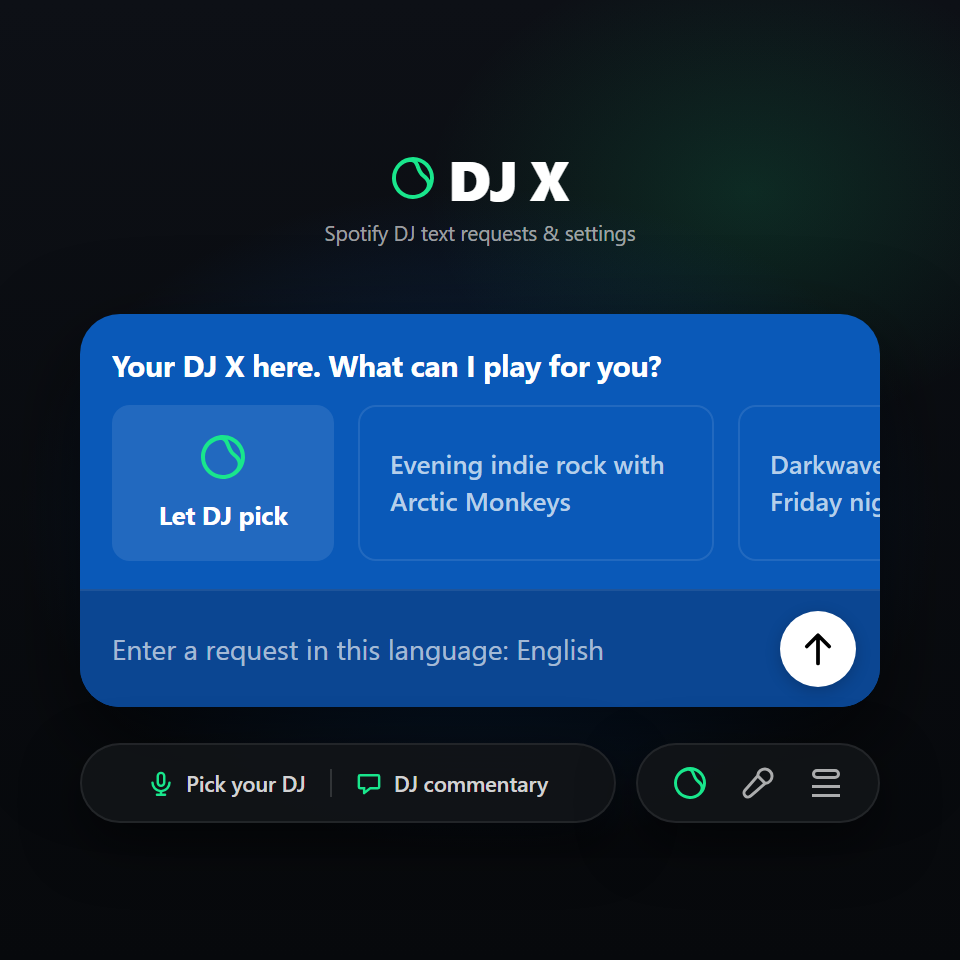

# DJ X

Send text requests to Spotify DJ directly from the desktop client. Open the panel, type what you want to hear or pick a suggestion, and Spotify DJ builds the set.

[](https://github.com/Shinsha1337/djx-spicetify/blob/main/preview.png?raw=true)

## Features

- **Player bar button**: Persistent DJ button left of Lyrics with native Spotify styling and hover state. Highlights in green while DJ is playing.
- **Right-click DJ settings**: Right-click the DJ button for **Pick your DJ** (14 voices across 6 languages, with audio previews) and **DJ commentary** (**Introduce each set** / **Don’t break the flow**), matching the mobile app.
- **Prompt suggestions**: Fetches up to 3 prompt cards from Spotify based on the currently playing track.
- **Let DJ pick**: Hands control back to DJ without a text prompt.
- **Session continuity**: Sending a request during an active DJ session updates the current set instead of restarting it.

## Requirements

- Official **Spotify Desktop** app from [spotify.com/download](https://www.spotify.com/download/) with Spicetify installed (the Microsoft Store version is not supported).
- **Spotify Premium** on an account with Spotify DJ available. Installing this extension does not unlock DJ on unsupported accounts.

## Installation through Spicetify Marketplace

This is the recommended installation method — Marketplace installations update automatically.

### 1\. Install Spotify Desktop

Install the official Spotify Desktop app from the [Spotify website](https://www.spotify.com/download/). Do not use the Microsoft Store version.

### 2\. Install Spicetify and Marketplace

Follow the [official Spicetify installation guide](https://spicetify.app/docs/getting-started.html), which has the current commands for your operating system. When the installer asks whether to install Marketplace, answer `yes`.

### 3\. Open Marketplace in Spotify

Open Spotify and select **Marketplace** from the sidebar.

### 4\. Find DJ X

Open the **Extensions** tab and search for **DJ X**.

### 5\. Install DJ X

Click **Install**. Restart Spotify if the extension does not appear immediately, then click the DJ icon in the player bar.

If DJ X is not in Marketplace yet, use the manual installation below.

## Manual installation

1. Install Spotify Desktop and Spicetify as described above.
2. Run `spicetify config-dir` and open the folder it prints.
3. Put `djx.js` into the `Extensions` folder.
4. Enable it and restart Spotify:

```
spicetify config extensions djx.js
spicetify apply
```

## Updates

**Marketplace installations update automatically** — nothing to do.

For a manual installation, replace `djx.js` in the `Extensions` folder with the new version and run `spicetify apply`.

Spotify Desktop updates can overwrite the files Spicetify patches, and DJ X may stop loading until you re-apply:

```
spicetify backup apply
```

## Removing DJ X

```
spicetify config extensions djx.js-
spicetify apply
```

Then delete `djx.js` from the `Extensions` folder. Marketplace installations are removed from the **Installed** tab. Requests are never stored, and an unsent draft lives only in memory until Spotify restarts.

## Usage

Click the DJ icon in the player bar or press **Shift + D** — the sheet opens above the player controls:

- **Type a request** — a mood, an artist, a genre or an activity — then press **Enter**.
- **Pick a suggestion** — click any card to send it as is; the row pages with the mouse wheel.
- **Let DJ pick** — hand the choice to DJ without describing anything.
- **Dismiss** — click outside the sheet or press **Escape**; the draft is kept until you send it.
- **DJ settings (right-click)** — right-click the DJ icon in the player bar to change DJ settings just like in the Spotify mobile app (**Pick your DJ** with voice previews and **DJ commentary**); if a DJ session is currently playing when you switch, you can restart DJ right away or apply it on the next session.

## Development

The shipped `djx.js` is a **generated bundle** — the source is modular:

- `src/01-core.js` — Spotify API surface, DJ catalog and commentary settings (`ProductStateAPI`), prompt signal encoding, the suggestion backend call, the request client, palette helpers, and the test seam
- `src/02-styles.js` — DJ icon paths, inline SVG icons and the whole stylesheet
- `src/03-panel.js` — the popup itself: opening, rendering, cards, caching, row paging, history, sending, closing
- `src/03-settings.js` — the right-click context menu, **Pick your DJ** voice picker with previews, **DJ commentary** selector, and **DJ will restart** prompt
- `src/04-boot.js` — player-bar button, player/settings listeners, global listeners and the public `window.DJX` handle

Edit the modules, then run `Build-DJX.ps1` — it concatenates them in order into the single file Spicetify expects (extensions are injected as one file), copies it into your `Extensions` folder and applies. Use `-NoApply` to skip applying, or `-NoInstall` to only build.

## Credits

Created by [Shinsha](https://github.com/Shinsha1337).
