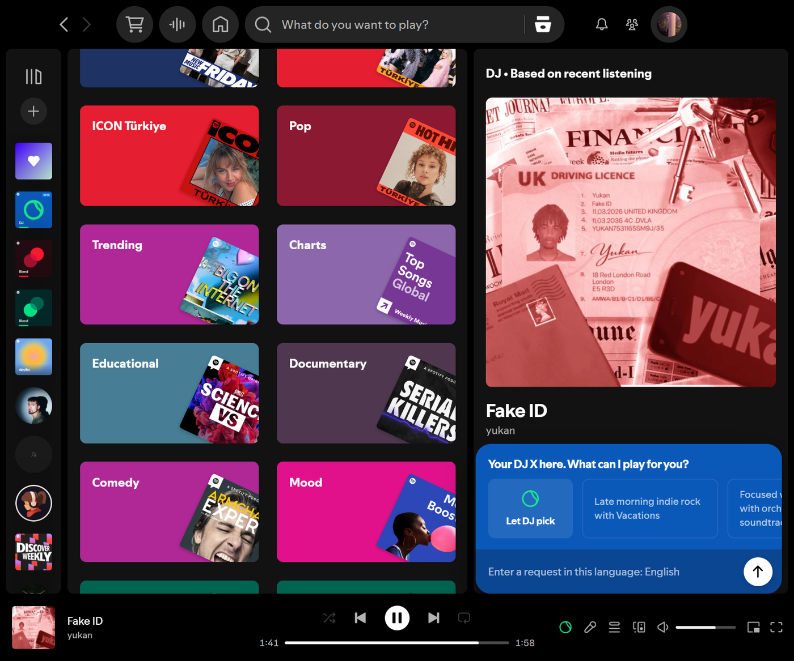

# DJ X

**DJ X** puts Spotify's real DJ one click away in the desktop client — open the sheet, say what you want to hear, and Spotify's own DJ builds the set and narrates it. No API key, no extra account, no background server: your existing session does the work.

[](https://github.com/Shinsha1337/djx-spicetify/blob/main/preview.png?raw=true)

## Features

- **Native DJ button** — sits in the player bar left of Lyrics, monochrome with Spotify's own tooltip and hover scale. It stays put while DJ narrates or a request is in flight, when Spotify's stock button disappears. While a DJ set is playing, the icon takes DJ's accent green.
- **Prompt ideas from Spotify** — the cards next to **Let DJ pick** are generated server-side for the track playing right now, with shimmering placeholders while they load. Nothing is hardcoded.
- **Let DJ pick** — hands the choice to DJ with no prompt at all, the way the phone's button does, so you never get "Based on your request" narration.
- **Phone-matched layout** — card sizes, gaps, corners and the outlined card style are measured from the mobile app, so the sheet reads as part of the client.
- **One notch, one page** — the idea row moves a whole pair at a time and always lands on a card start. No half-cut cards at the edges, on any window size.
- **Closes on send** — the sheet goes away the moment a request is out; DJ works in the background and failures arrive as Spotify's own notification.
- **No repeated introductions** — a request sent while DJ is already playing goes into the running session instead of restarting it.

## Important compatibility note

DJ X works through Spicetify, so it requires the official **Spotify Desktop** app. Spicetify does **not** work with the Microsoft Store version of Spotify — install the desktop app from the [official Spotify website](https://www.spotify.com/download/).

DJ requests require **Spotify Premium** and an account or region where Spotify has enabled the DJ feature. Installing the extension does not enable DJ for unsupported accounts.

## Installation through Spicetify Marketplace

This is the recommended installation method — Marketplace installations update automatically.

### 1\. Install Spotify Desktop

Install the official Spotify Desktop app from the [Spotify website](https://www.spotify.com/download/). Do not use the Microsoft Store version.

### 2\. Install Spicetify and Marketplace

Follow the [official Spicetify installation guide](https://spicetify.app/docs/getting-started.html), which has the current commands for your operating system. When the installer asks whether to install Marketplace, answer `yes`.

### 3\. Open Marketplace in Spotify

Open Spotify and select **Marketplace** from the sidebar.

### 4\. Find DJ X

Open the **Extensions** tab and search for **DJ X**.

### 5\. Install DJ X

Click **Install**. Restart Spotify if the extension does not appear immediately, then click the DJ icon in the player bar.

If DJ X is not in Marketplace yet, use the manual installation below.

## Manual installation

1. Install Spotify Desktop and Spicetify as described above.
2. Run `spicetify config-dir` and open the folder it prints.
3. Put `djx.js` into the `Extensions` folder.
4. Enable it and restart Spotify:

```
spicetify config extensions djx.js
spicetify apply
```

## Updates

**Marketplace installations update automatically** — nothing to do.

For a manual installation, replace `djx.js` in the `Extensions` folder with the new version and run `spicetify apply`.

Spotify Desktop updates can overwrite the files Spicetify patches, and DJ X may stop loading until you re-apply:

```
spicetify backup apply
```

## Removing DJ X

```
spicetify config extensions djx.js-
spicetify apply
```

Then delete `djx.js` from the `Extensions` folder. Marketplace installations are removed from the **Installed** tab. Requests are never stored, and an unsent draft lives only in memory until Spotify restarts.

## Usage

Click the DJ icon in the player bar or press **Shift + D** — the sheet opens above the player controls:

- **Type a request** — a mood, an artist, a genre or an activity — then press **Enter**.
- **Pick a suggestion** — click any card to send it as is; the row pages with the mouse wheel.
- **Let DJ pick** — hand the choice to DJ without describing anything.
- **Dismiss** — click outside the sheet or press **Escape**; the draft is kept until you send it.

## Development

The shipped `djx.js` is a **generated bundle** — the source is modular:

- `src/01-core.js` — Spotify API surface, prompt signal encoding, the suggestion backend call, the request client, palette helpers, and the test seam
- `src/02-styles.js` — DJ icon paths, inline SVG icons and the whole stylesheet
- `src/03-panel.js` — the popup itself: opening, rendering, cards, sending, closing
- `src/04-boot.js` — player-bar button, row paging, global listeners and the public `window.DJX` handle

Edit the modules, then run `Build-DJX.ps1` — it concatenates them in order into the single file Spicetify expects (extensions are injected as one file), copies it into your `Extensions` folder and applies. Use `-NoApply` to skip applying, or `-NoInstall` to only build.

## Credits

Created by [Shinsha](https://github.com/Shinsha1337).
